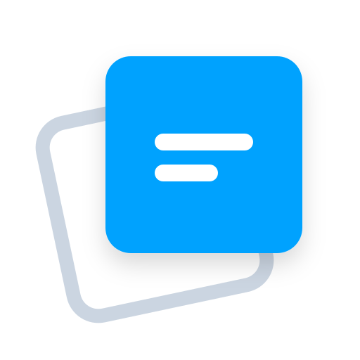

<div align="center">
  
  <h1>FloatBoard Website &amp; Landing Page</h1>
  <p>The official marketing website, documentation, and purchase portal for <strong><a href="https://floatboard.xyz">FloatBoard</a></strong> — the always-on-top desktop clipboard, notes, and visual reference board.</p>

  <p>
    <a href="https://floatboard.xyz"></a>
    <a href="https://github.com/nazihyazan/floating_board"></a>
    <a href="https://snapcraft.io/floatboard"></a>
    
  </p>
</div>

<br/>

## Overview

This repository hosts the static frontend and publishing pipeline for **[floatboard.xyz](https://floatboard.xyz)**. The site is optimized for ultra-fast performance, high conversion, and strict search engine compliance (SEO).

### Key Highlights
- **100% Static & Blazing Fast:** Deployed on Cloudflare Pages with zero client-side framework overhead.
- **Cross-Platform Distribution:** Direct native installers for Windows (`.exe`), macOS (`.zip`), and Linux (`.deb`, `.rpm`, `.AppImage`, and Canonical Snap Store).
- **Search Intent & Programmatic SEO:** Dedicated comparison and alternative landing pages targeting high-intent desktop productivity queries.
- **Automated Blog & Feed Engine:** Static generation of 19 in-depth workflow guides via Python, maintaining automated XML sitemaps and JSON-LD schema.
- **Strict SEO Verification:** Built-in validator ensuring 100% valid canonical tags, accessible assets, unique metadata, and zero broken local links.

---

## Directory Structure

```text
floatboard-landing/
├── _headers                 # Cloudflare Pages HTTP response headers (XML MIME type, caching, security)
├── alternatives/            # High-intent alternative pages (PureRef, Windows Sticky Notes, Ditto/CopyQ)
├── assets/                  # Core CSS, icons, and UI assets
├── blog/                    # Static blog guides, articles, and media
│   ├── assets/              # WebP/JPG/PNG figures and recorded workflow MP4s
│   ├── posts.json           # Single source of truth for all blog articles
│   └── README.md            # Editorial and publication guidelines
├── compare/                 # Side-by-side competitor comparisons (PowerToys Always on Top)
├── download/                # Native multi-OS downloads hub (Windows, Mac, Linux)
├── linux/                   # Linux-specific distro guide and Snapcraft installation instructions
├── scripts/                 # Build and test tooling
│   ├── build-blog.py        # Generates static HTML guides and dual sitemaps
│   └── check-seo.py         # Complete SEO, link integrity, and JSON-LD validator
├── sitemap.xml              # Canonical sitemap (34 validated pages)
├── sitemap-main.xml         # Secondary sitemap mirror for search console cache-busting
├── robots.txt               # Crawler directives pointing to both sitemaps
└── index.html               # Main landing page with live animations and checkout portal
```

---

## High-Intent Landing Pages

| Page Path | Target Query / Angle | Primary OS |
| --- | --- | --- |
| `/clipboard-manager.html` | Floating clipboard manager without losing window focus | Windows / macOS / Linux |
| `/floating-notes.html` | Always-on-top translucent sticky notes & checklists | Windows / macOS / Linux |
| `/download/` | Multi-platform native downloads & verification | All Platforms |
| `/alternatives/pureref-with-text-and-clipboard.html` | PureRef alternative supporting text notes & clipboard history | All Platforms |
| `/compare/floatboard-vs-powertoys-always-on-top.html` | PowerToys Always on Top alternative (compact floating cards) | Windows |
| `/alternatives/windows-sticky-notes-always-on-top.html` | Windows Sticky Notes "Always on Top" missing feature | Windows 11 & 10 |
| `/alternatives/ditto-copyq-visual-clipboard.html` | Modern visual card clipboard replacing Ditto and CopyQ | Windows / Linux |
| `/linux/floating-clipboard-notes-ubuntu.html` | Lightweight floating clipboard and snippet pad for Ubuntu | Linux |

---

## Tooling & Development

### 1. Build Blog & Sitemaps
Generates all 19 blog articles, update dates, schema metadata, and synchronizes both `sitemap.xml` and `sitemap-main.xml`:

```bash
npm run build:blog
# or directly:
python3 scripts/build-blog.py
```

### 2. Validate SEO & Link Integrity
Checks all 34 canonical URLs listed in the sitemap for single canonical tags, exact H1 count, unique titles and descriptions, accessible media, and internal fragment targets:

```bash
npm test
# or:
npm run check:seo
```

---

## Deployment (Cloudflare Pages)

Pushes to the `main` branch automatically trigger automated deployments on Cloudflare Pages.

- **Clean URLs:** Cloudflare Pages resolves extensionless URLs (e.g. `/download` -> `/download/` or `/clipboard-manager` -> `/clipboard-manager.html`).
- **Assets Filter:** `.assetsignore` prevents files larger than 25 MiB (such as local installer binaries) from exceeding deploy limits.
- **HTTP Headers:** `_headers` forces `Content-Type: application/xml; charset=utf-8` on XML sitemaps and sets cache-invalidation headers.

---

## Legal & Contact

- [Terms of Service](https://floatboard.xyz/terms.html)
- [Privacy Policy](https://floatboard.xyz/privacy.html)
- [Refund Policy](https://floatboard.xyz/refund.html)
- [SEO Notes & Audit History](SEO-NOTES.md)
